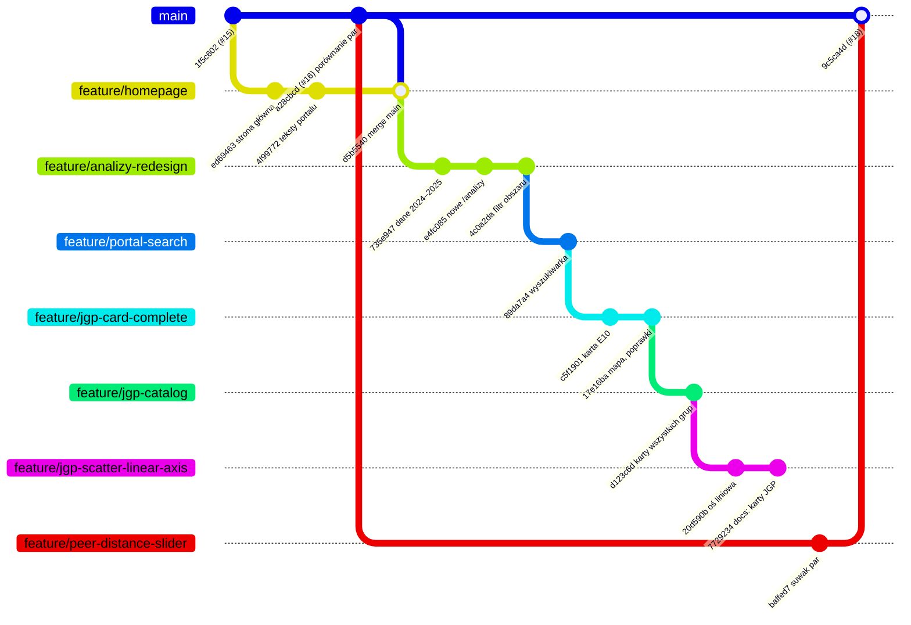

# Branche od przebudowy strony głównej

Stan na 2 listopada 2026 r. Opis obejmuje branche od rozpoczęcia przebudowy strony głównej (`feature/homepage`, 28 października 2026 r.).

## W skrócie

- Główna praca to **łańcuch sześciu branchy**. Każdy następny zaczyna się od końca poprzedniego. Najnowszy, `feature/jgp-scatter-linear-axis`, zawiera wszystko z wcześniejszych.
- **Żaden branch z łańcucha nie jest jeszcze w `main`.**
- Obok łańcucha jest jeden ważny **branch boczny**: suwak odległości par, w `main` jako PR #18. Od 2 listopada 2026 r. łańcuch go zawiera (merge `origin/main` do `feature/jgp-scatter-linear-axis`).

## Schemat



Ten sam układ w prostszej formie:

```text
main (1f5c602, #15)
 ├─ feature/homepage  (+ merge main z #16)
 │   └─ feature/analizy-redesign
 │       └─ feature/portal-search
 │           └─ feature/jgp-card-complete
 │               └─ feature/jgp-catalog
 │                   └─ feature/jgp-scatter-linear-axis   ← tu pracujemy
 │
main (a28cbcd, #16)
 └─ feature/peer-distance-slider ─────────────► w main jako #18 (9c5ca4d)
```

## Łańcuch główny

| # | Branch | Wychodzi z | Co wnosi | Ostatni commit |
|---|---|---|---|---|
| 1 | `feature/homepage` | `main` (1f5c602), potem merge `main` z #16 | strona główna portalu, panel przeniesiony do `/analizy`, `CLAUDE.md`, ilustracja hero, teksty o publicznej ochronie zdrowia | d5b5540, 29.10 |
| 2 | `feature/analizy-redesign` | `feature/homepage` | dane z lat 2024–2025 i wybór roku, widok „W czasie”, pierwsza strona grupy JGP, nowe `/analizy` (eksplorator pytań), szpitale poza `/analizy`, filtr obszaru | 4c0a2da, 30.10 |
| 3 | `feature/portal-search` | `feature/analizy-redesign` | wyszukiwarka grup JGP i szpitali (etap 1 roadmapy) | 89da7a4, 30.10 |
| 4 | `feature/jgp-card-complete` | `feature/portal-search` | pełna karta E10 (etap 2), mapa województw, dane budowane skryptami w `scripts/`, paleta (zielony interfejs, niebieskie dane) | 17e16ba, 31.10 |
| 5 | `feature/jgp-catalog` | `feature/jgp-card-complete` | karty wszystkich grup JGP i katalog `/jgp` (etap 3) | d123c6d, 31.10 |
| 6 | `feature/jgp-scatter-linear-axis` | `feature/jgp-catalog` | oś liniowa na wykresach punktowych karty; dokumenty koncepcyjne kart i sygnałów w `docs/` | 743b25a, 2.11 |

Każdy branch zawiera wszystkie wcześniejsze. `feature/jgp-scatter-linear-axis` ma 26 commitów ponad `origin/main`.

## Branch boczny

| Branch | Wychodzi z | Co wnosi | Stan |
|---|---|---|---|
| `feature/peer-distance-slider` | `main` (a28cbcd) | suwak odległości par w porównaniu szpitali | w `main` jako PR #18 (9c5ca4d); dołączony do łańcucha 2.11 |

## Co z tego wynika przy scalaniu do `main`

1. **Najprościej: jeden PR z `feature/jgp-scatter-linear-axis`.** Zawiera cały łańcuch. Osobne PR-y dla każdego branchu z kolejnym squash merge powodują konflikty w następnych branchach, bo squash zmienia historię.
2. **`main` z #18 jest już dołączony** (2.11). Konflikty rozwiązane: `Dashboard.tsx` usunięty, parametr `pd` przeniesiony do stanu strony `/szpitale` (`hospitalUrlState.ts`).
3. **Lokalny `main` jest nieaktualny** (1f5c602, bez #16 i #18). Przed pracą z `main` trzeba go zaktualizować z `origin/main`.
4. **Push do `main` = wdrożenie na Cloudflare Pages.** Do `main` tylko przez PR (squash merge).
